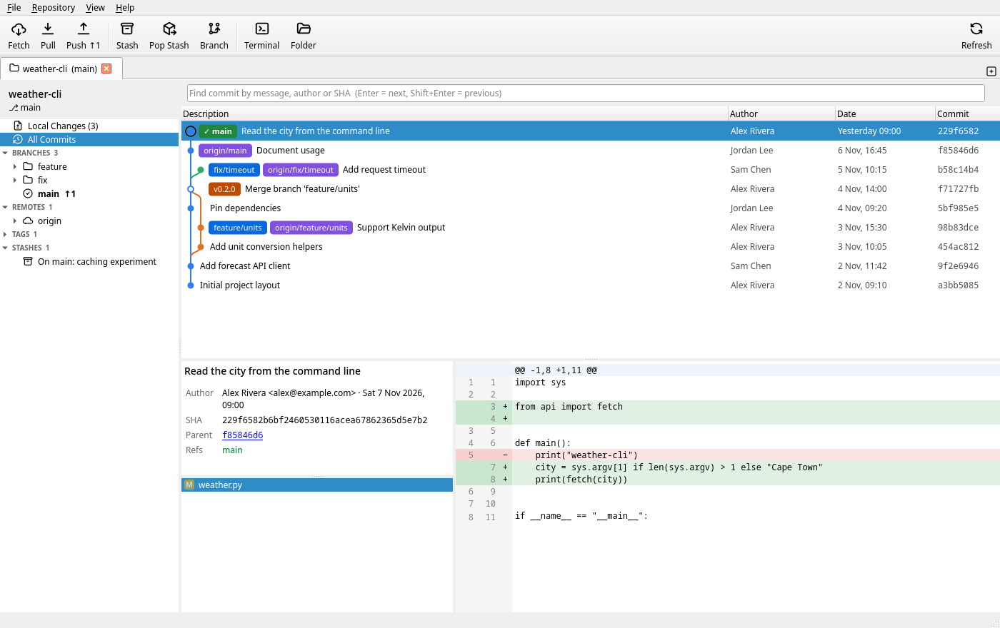
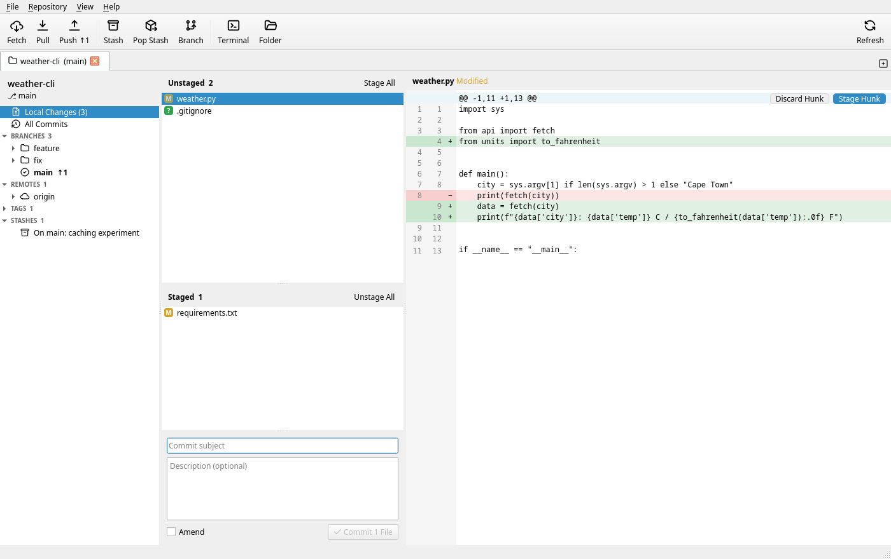
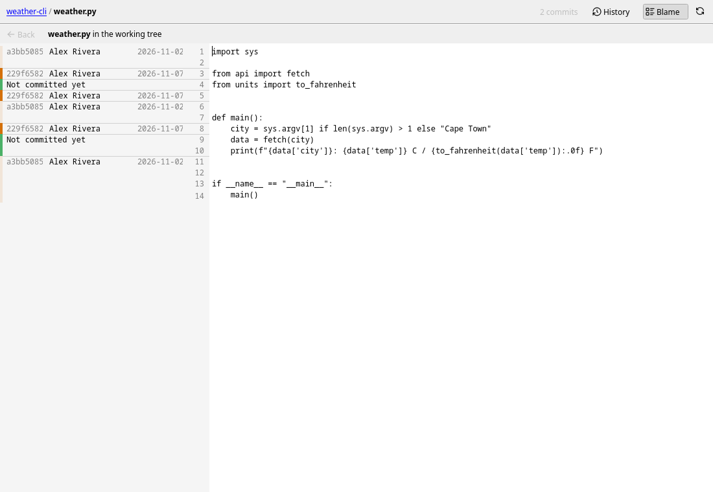

# aslgc

[](https://github.com/kyleschouw/aslgc/actions/workflows/build.yml)

**a simple linux git client**: a fast, native Git GUI for the Linux desktop, built with C++20 and Qt 6.



aslgc runs the `git` command line underneath, so your hooks, commit signing, credential
helpers and `~/.gitconfig` behave exactly as they do in a terminal.

## Features

- **Repository tabs** with session restore and a recent-repositories start page
- **Commit graph** with coloured lanes, branch / tag / remote labels, commit details and per-file diffs; search by message, author or SHA; select several commits to compare them or save them as patches
- **Local changes**: stage, unstage or discard whole files, single hunks or just the lines you select; commit and amend
- **Branches, remotes, tags and stashes** in a sidebar, each with a context menu: checkout, create, rename, delete, track, fast-forward, merge (ff / no-ff / ff-only / squash), rebase, cherry-pick, revert, reset, tag, stash
- **Interactive rebase**: reorder, reword, edit, squash, fix up or drop commits in a dialog; edit any commit's message
- **git-flow**: set up, start and finish features, bugfixes, releases and hotfixes (fetch, merge, tag, delete, push) from the toolbar or a branch's menu; support branches for older release lines; shares its settings with the git-flow command line tool
- **File history and blame**: the history of any file (following renames), folder or selected lines on the current branch, another branch or all of them, with uncommitted changes on top; a line-by-line blame that clicks through to each commit, steps back to earlier revisions and can ignore whitespace or follow moved and copied lines
- **Reflog**: every checkout, commit, reset, merge and rebase of HEAD or a branch, in its own window; commits left behind by an amend, reset or rebase are marked and can be shown in the commit graph, ready to be rescued with a branch
- **Fetch, pull and push** with a progress dialog; credential and SSH passphrase prompts handled in the GUI
- **Conflicts**: highlighted conflict markers, resolve with ours / theirs / merge tool, and a Continue · Skip · Abort banner for merges, rebases, cherry-picks and reverts
- **GitHub & GitLab accounts** (including Enterprise / self-managed): clone from your repository list, create pull / merge requests, open commits and branches on the web, token-based HTTPS authentication
- Follows your desktop's light or dark theme





See [TODO.md](TODO.md) for the roadmap.

## Building

### Requirements

| | Minimum |
| --- | --- |
| Compiler | C++20 (GCC 11 or Clang 14) |
| CMake | 3.21 |
| Qt 6 | 6.4: Core, Gui, Widgets, Concurrent, Network, Svg (Test for the test suite) |
| QtKeychain | built against Qt 6 |
| git (runtime) | 2.31 |

Optional: Qt Linguist tools (`lrelease`) to compile translations; without them the UI
is built untranslated.

A Secret Service provider (GNOME Keyring, KWallet, KeePassXC…) is needed at runtime to
store GitHub / GitLab account tokens. Everything else works without one.

### Dependencies by distribution

```sh
# Arch Linux / Manjaro / EndeavourOS / CachyOS
sudo pacman -S --needed base-devel cmake git qt6-base qt6-svg qtkeychain-qt6 qt6-tools

# Debian 12+ / Ubuntu 24.04+ / Linux Mint 22+
sudo apt install build-essential cmake git libgl-dev qt6-base-dev qt6-svg-dev qtkeychain-qt6-dev qt6-tools-dev qt6-l10n-tools

# Fedora
sudo dnf install gcc-c++ cmake git qt6-qtbase-devel qt6-qtsvg-devel qtkeychain-qt6-devel qt6-qttools-devel
```

On other distributions, install the development packages for the components listed above.

### Build, test and run

```sh
cmake -S . -B build -DCMAKE_BUILD_TYPE=Release
cmake --build build -j"$(nproc)"
ctest --test-dir build --output-on-failure
./build/aslgc [path/to/repository]
```

### Install

```sh
sudo cmake --install build                  # into /usr/local
# or, for packaging:
DESTDIR="$pkgdir" cmake --install build --prefix /usr
```

This installs:

| Path (relative to the prefix) | |
| --- | --- |
| `bin/aslgc` | the application |
| `libexec/aslgc/aslgc-askpass` | internal credential prompt / git credential helper |
| `share/applications/io.github.kyleschouw.aslgc.desktop` | desktop entry |
| `share/metainfo/io.github.kyleschouw.aslgc.metainfo.xml` | AppStream metadata |
| `share/icons/hicolor/*/apps/io.github.kyleschouw.aslgc.png` | icons, 16–512 px |
| `share/man/man1/aslgc.1` | man page |
| `share/doc/aslgc/` | README, CHANGELOG, LICENSE, third-party notices |

The install is relocatable: `aslgc` finds its helper relative to its own location.

### Build options

| Option | Default | |
| --- | --- | --- |
| `CMAKE_BUILD_TYPE` | `RelWithDebInfo` | |
| `CMAKE_INSTALL_PREFIX` | `/usr/local` | |
| `BUILD_TESTING` | `ON` | build `aslgc-tests` (needs Qt Test) |
| `ASLGC_GITHUB_CLIENT_ID` | empty | GitHub OAuth App client ID; enables browser sign-in (see below) |

## GitHub & GitLab accounts

**File → Accounts…** signs in to GitHub, GitHub Enterprise, GitLab or a self-managed GitLab
with a personal access token. **Create Token in Browser…** opens the token page with the
required scopes preselected. aslgc checks the token against the API, then stores it in the
system keyring. Only the user name and host are written to `~/.config/aslgc/`.

With an account signed in:

- **Clone → Choose from GitHub / GitLab Account…** lists your repositories.
- **HTTPS fetch, pull and push** to that host use the token automatically. aslgc acts as
  git's credential helper for that host only and never edits your git configuration.
- **Right-click a pushed branch → Create Pull Request… / Create Merge Request…** creates
  it through the API, prefilled from the branch's commits. Without an account it opens
  the new-request page in your browser instead.
- **Open in GitHub / GitLab** is available for remotes, branches and commits.

### Browser sign-in for GitHub (optional)

GitHub accounts can also sign in through the browser using GitHub's OAuth device flow,
so no token needs to be copied. This requires the Client ID of a GitHub OAuth App, set at build
time. Client IDs are public, and no client secret is used.

1. Create an OAuth App at <https://github.com/settings/applications/new>: any name and
   homepage, callback URL `http://127.0.0.1` (required by the form, unused by the device flow).
2. Tick **Enable Device Flow** and save.
3. Build with `-DASLGC_GITHUB_CLIENT_ID=<client id>`, or set the `ASLGC_GITHUB_CLIENT_ID`
   environment variable to try it without rebuilding.

Organisations that restrict OAuth Apps must approve the app before their private
repositories become visible.

## Privacy

aslgc has no telemetry. It only contacts the git remotes you work with and, if you add
accounts, the GitHub / GitLab APIs of those hosts. Tokens live in the system keyring.

## Keyboard shortcuts

| Action | Shortcut |
| --- | --- |
| New tab / close tab | Ctrl+T / Ctrl+W |
| Open / clone repository | Ctrl+O / Ctrl+Shift+O |
| Local Changes / All Commits | Ctrl+1 / Ctrl+2 |
| Find commit | Ctrl+F |
| Commit | Ctrl+Enter |
| Stage / unstage selected file | Space, Enter or double-click |
| Fetch / Pull / Push | Ctrl+Shift+F / Ctrl+Shift+L / Ctrl+Shift+P |
| Stash | Ctrl+Alt+S |
| New branch | Ctrl+Shift+B |
| Open terminal | Ctrl+Alt+T |
| Refresh | F5 or Ctrl+R |

## Contributing

Bug reports and pull requests are welcome. [CONTRIBUTING.md](CONTRIBUTING.md) covers the
code layout, style and tests.

## License

aslgc is released under the [MIT License](LICENSE). The bundled action icons
(Tabler Icons, MIT) and the elements of the app icon (the Git logo, CC BY 3.0, and Tux)
are covered by their own terms. See [THIRD_PARTY_NOTICES.md](THIRD_PARTY_NOTICES.md).
